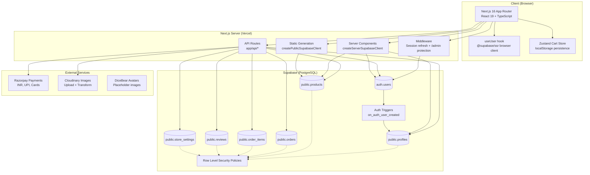
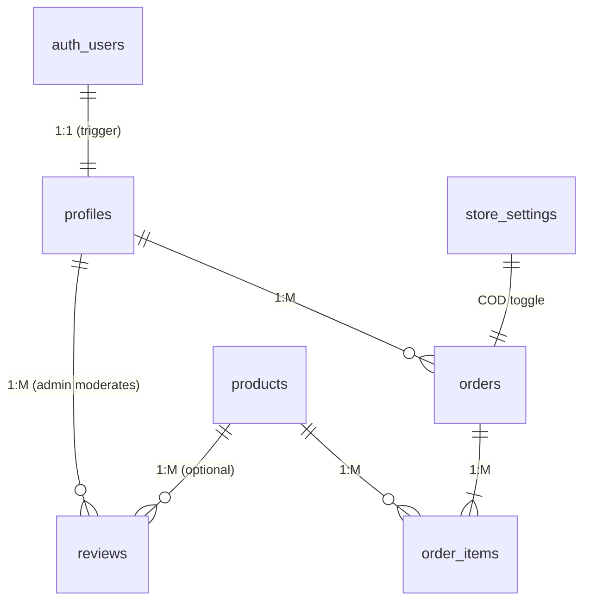

# Architecture Overview

## System Diagram



## Technology Stack

| Layer | Technology | Version |
|-------|------------|---------|
| Framework | Next.js | 16.2.9 (App Router) |
| Runtime | React | 19.2.4 |
| Language | TypeScript | 5.x (strict) |
| Styling | Tailwind CSS | 4.x |
| State Management | Zustand | 5.0.14 |
| Database | Supabase (PostgreSQL) | Managed |
| Authentication | Supabase Auth | @supabase/ssr 0.12.0 |
| Payments | Razorpay | REST API |
| Images | Cloudinary | REST API |
| Charts | Recharts | 3.9.0 |
| Icons | Lucide React + React Icons | 1.30.0 / 5.7.0 |

## Route Architecture

```
app/
├── (shop)/              # Public storefront (layout with Navbar/Footer)
│   ├── page.tsx         # Homepage
│   ├── products/
│   │   ├── page.tsx     # Product listing (search, filter)
│   │   └── [slug]/page.tsx  # Product detail
│   ├── cart/page.tsx    # Cart (Zustand)
│   ├── checkout/page.tsx # Checkout + Razorpay
│   ├── order-success/[id]/page.tsx
│   ├── orders/page.tsx  # Order history (requireUser)
│   ├── orders/[id]/page.tsx
│   ├── profile/page.tsx # Profile management (requireUser)
│   └── layout.tsx
├── (auth)/              # Auth pages (centered card layout)
│   ├── login/page.tsx
│   ├── signup/page.tsx
│   └── layout.tsx
├── (admin)/admin/       # Admin panel (sidebar layout)
│   ├── page.tsx         # Dashboard (stats)
│   ├── products/        # Product CRUD
│   ├── orders/          # Order management
│   ├── users/           # User list (service role)
│   ├── reviews/         # Review moderation
│   ├── settings/        # Store settings
│   └── layout.tsx       # Server-side admin check
├── api/                 # REST API routes
│   ├── products/
│   ├── orders/
│   ├── profile/
│   ├── payment/
│   ├── upload/
│   ├── admin/
│   ├── settings/
│   └── reviews/
├── sitemap.ts           # Auto-generated
├── robots.ts            # Auto-generated
└── layout.tsx           # Root layout (fonts, metadata)
```

## Data Flow Patterns

### 1. Server-Side Rendering (SSR)
```
Request → Middleware (session refresh) → Server Component
    → createServerSupabaseClient() (cookie-aware)
    → Supabase query with RLS
    → Response with Set-Cookie headers
```

### 2. Client-Side Data Fetching
```
Browser → useUser() hook → createBrowserClient()
    → supabase.auth.getUser() + onAuthStateChange
    → UI updates reactively
```

### 3. API Route (Authenticated)
```
Request → API Route → requireUser()/requireAdmin()
    → createServerSupabaseClient()
    → Supabase query (RLS enforced)
    → JSON response { data?, error? }
```

### 4. Static Generation (Build Time)
```
Build → generateStaticParams / sitemap.ts
    → createPublicSupabaseClient() (no cookies)
    → Supabase query (public data only)
    → Static HTML/JSON output
```

## Authentication Boundaries

| Route Pattern | Protection | Mechanism |
|---------------|------------|-----------|
| `/admin/*` | Required (admin only) | Middleware redirect + server layout check |
| `/profile`, `/orders/*`, `/checkout` | Required (user) | Client-side `useUser()` redirect |
| `/api/admin/*` | Required (admin) | `requireAdmin()` → service role for auth.users |
| `/api/orders`, `/api/profile` | Required (user) | `requireUser()` |
| `/api/products`, `/api/upload` | Optional / Public | No auth guard (upload requires user) |
| `/`, `/products/*` | Public | No auth |

## Database Relationships



## Deployment Architecture

```
┌─────────────────────────────────────────────────────────────┐
│                        GitHub                                │
│  main (production) ← PR ← dev ← feature branches            │
└──────────────────────────┬──────────────────────────────────┘
                           │ Push/PR
                           ▼
┌─────────────────────────────────────────────────────────────┐
│                    GitHub Actions CI                         │
│  npm ci → tsc --noEmit → npm run build                      │
│  Env: Supabase, Razorpay, Cloudinary secrets                │
└──────────────────────────┬──────────────────────────────────┘
                           │ Merge to main
                           ▼
┌─────────────────────────────────────────────────────────────┐
│                     Vercel Deploy                            │
│  - Auto-deploy on main                                      │
│  - Preview deployments on PR                                │
│  - Environment variables from Vercel dashboard              │
│  - Custom domain: ganagallery.shop                          │
└──────────────────────────┬──────────────────────────────────┘
                           │ Runtime
                           ▼
┌─────────────────────────────────────────────────────────────┐
│                    Production Services                       │
│  - Next.js on Vercel Edge/Serverless                        │
│  - Supabase (PostgreSQL + Auth + Realtime)                  │
│  - Razorpay (payment processing)                            │
│  - Cloudinary (image delivery + upload)                     │
└─────────────────────────────────────────────────────────────┘
```

## Known Gaps (Current State)

- No `/auth/callback` route for email confirmation handling
- No password reset flow
- No webhook handler for Razorpay (relies on client-side verification)
- No background jobs / cron
- No analytics / monitoring
- No automated testing
- Email confirmation redirect uses Supabase Dashboard Site URL (breaks on Vercel previews)