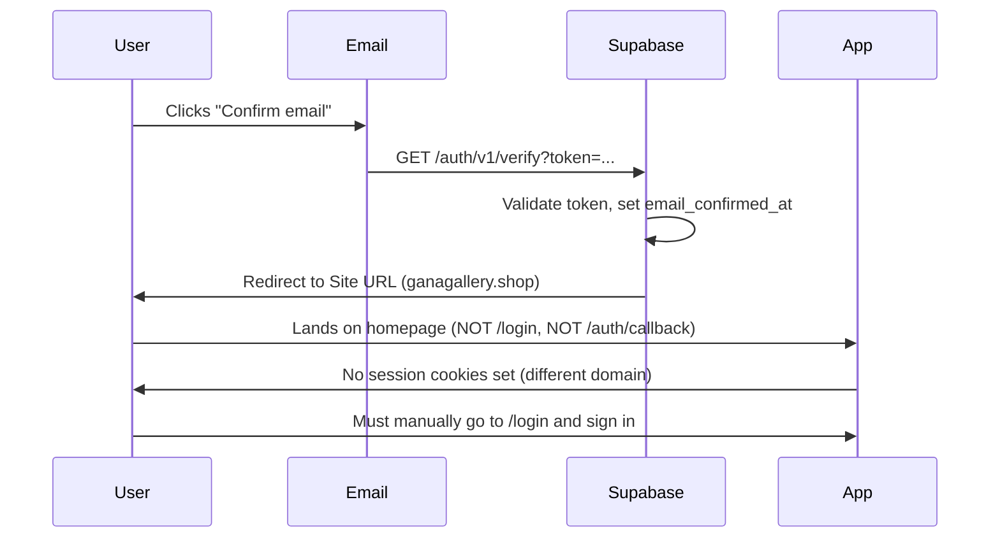

# Signup & Email Confirmation Flow

## Current Implementation

### Signup API Call (`lib/auth.ts:34-38`)

```typescript
export async function signUp(email: string, password: string) {
  const supabase = createClient()
  const { data, error } = await supabase.auth.signUp({ email, password })
  if (error) throw new Error(error.message)
  return data
}
```

**No `emailRedirectTo` option is provided.**

### Signup Form (`app/(auth)/signup/page.tsx`)

1. Validates password match and minimum 6 characters
2. Calls `signUp(email, password)`
3. On success: shows "Check your inbox" message, redirects to `/login` after 2 seconds
4. No "Resend confirmation" button
5. No handling for already-confirmed / expired-token states

## Supabase Email Confirmation Behavior

### What Supabase Does (Default)

1. User submits signup → `auth.users` row created with `email_confirmed_at = NULL`
2. Supabase sends confirmation email with link:
   ```
   https://<project-ref>.supabase.co/auth/v1/verify?token=<jwt>&type=signup&redirect_to=<Site URL>
   ```
3. **Redirect URL source (priority):**
   1. `options.emailRedirectTo` from `signUp()` call → **NOT PROVIDED**
   2. Supabase Dashboard → Authentication → URL Configuration → **Site URL**
   3. First URL in "Redirect URLs" list

### Current Configuration

| Setting | Value |
|---------|-------|
| `NEXT_PUBLIC_SITE_URL` (code fallback) | `https://www.ganagallery.shop` |
| Supabase Dashboard Site URL | Unknown (must be configured in dashboard) |
| `emailRedirectTo` in code | **Not set** |

## Environment-Specific Behavior

| Environment | Actual Redirect | Result |
|-------------|-----------------|--------|
| **Production** (`ganagallery.shop`) | `https://www.ganagallery.shop` | Works if Site URL matches |
| **Development** (`localhost:3000`) | `https://www.ganagallery.shop` | **Broken** - wrong domain |
| **Vercel Preview** (`xxx.vercel.app`) | `https://www.ganagallery.shop` | **Broken** - wrong domain |

## What Happens After Clicking Confirmation Link



**Critical Issue:** The confirmation flow never touches the Next.js app, so no session cookies are established.

## Missing Components

| Component | Status | Impact |
|-----------|--------|--------|
| `/auth/callback` route | **Missing** | No app-controlled confirmation landing |
| `emailRedirectTo` in `signUp()` | **Missing** | Relies on dashboard config |
| "Resend confirmation" UI | **Missing** | User stuck if email lost |
| Expired token handling | **Missing** | Generic Supabase error page |
| Password reset flow | **Missing** | No account recovery |

## Planned Fix (Not Implemented)

### Minimal Change for Production

**File:** `lib/auth.ts:36`

```typescript
const { data, error } = await supabase.auth.signUp({ 
  email, 
  password,
  options: {
    emailRedirectTo: `${process.env.NEXT_PUBLIC_SITE_URL ?? 'https://www.ganagallery.shop'}/login`
  }
})
```

**Also required:** Set `NEXT_PUBLIC_SITE_URL=https://www.ganagallery.shop` in Vercel production environment.

### Complete Fix (Future)

1. Add `app/(auth)/callback/page.tsx` to handle confirmation tokens
2. Implement "Resend confirmation" button on signup/login pages
3. Add password reset pages (`/forgot-password`, `/reset-password`)
4. Make `emailRedirectTo` dynamic for preview deployments (`window.location.origin + '/auth/callback'`)
5. Customize Supabase email templates

## Testing Checklist

- [ ] Signup on production → email received → link works → user logged in
- [ ] Signup on localhost → email received → link works (currently fails)
- [ ] Signup on Vercel preview → email received → link works (currently fails)
- [ ] Expired token (24h+) → appropriate error message
- [ ] Already confirmed email → appropriate handling
- [ ] Resend confirmation → new email sent